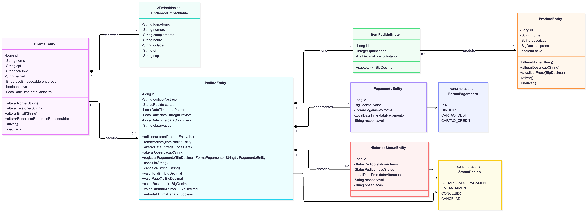

# Sistema de Gestão de Clientes e Pedidos para uma Salgateria

**Equipe:** Bruna, Eulyna, Joalis, Lenilson

Projeto da Segunda Unidade de BackEnd Avançado (UNIESP).

---

## 1. Apresentação da proposta

Sistema CRM para auxiliar na gestão dos clientes, dos pedidos e do relacionamento com os consumidores de uma salgateria, centralizando as informações e melhorando a organização do negócio.

Para atrair novos clientes, serão utilizadas estratégias de marketing digital, principalmente anúncios patrocinados no Instagram.

## 2. Funcionalidades (primeira versão)

- **Cadastro de clientes:** registro de nome, CPF e endereço, mantendo o histórico de relacionamento e compras.
- **Gestão de pedidos:** cadastro das encomendas, com produtos, quantidades, valores e datas de entrega.
- **Pagamento em duas etapas:** para confirmar o pedido, o cliente deve pagar no mínimo **50%** do valor total. O restante é quitado **na entrega**. O cliente também pode pagar mais de 50%, ou até 100%, antecipadamente. O pedido só é confirmado após o pagamento mínimo e só é concluído após a quitação do saldo restante.
- **Identificação e rastreamento:** após a confirmação do pedido (pagamento mínimo de 50%), é gerado um código de identificação para localizar e acompanhar o pedido.
- **Acompanhamento de status:** os pedidos podem estar aguardando pagamento, em andamento, concluídos ou cancelados.
- **Gestão de clientes:** identificação de clientes frequentes e consulta ao histórico de compras, a partir dos pedidos realizados, auxiliando promoções e estratégias de relacionamento.

## 3. Objetivo do projeto

Centralizar as informações dos clientes e pedidos, facilitar o acompanhamento das encomendas, melhorar o relacionamento com os consumidores e oferecer ao proprietário uma visão mais organizada do negócio, incluindo o controle do que já foi pago e do que falta receber em cada pedido.

## 4. Regras de negócio principais

| Regra | Descrição |
|---|---|
| Pagamento mínimo | O pedido só é confirmado quando o total pago atinge pelo menos 50% do valor total. |
| Pagamento adicional | O cliente pode pagar acima de 50%, inclusive 100% antecipado. A soma dos pagamentos nunca pode ultrapassar o total do pedido. |
| Conclusão | O pedido só pode ser concluído com o saldo restante quitado. |
| Código de rastreio | Gerado somente na confirmação do pedido. |
| Cancelamento | Pedido já concluído não pode ser cancelado. |

## 5. Fora do escopo da primeira versão (melhorias futuras)

- **Programa de fidelidade:** acúmulo de pontos conforme o valor das compras, com troca por descontos ou benefícios e consulta de saldo e histórico.
- **Chatbot** para automatizar o atendimento, apresentar os produtos e facilitar a realização de pedidos.

## 6. Pontos ainda a confirmar com o proprietário

- Em caso de cancelamento após o pagamento da entrada, o valor é devolvido, retido ou parcialmente devolvido?
- Qual o prazo para pagamento da entrada antes de o pedido aguardando pagamento expirar?
- Como tratar alterações no pedido após a confirmação, já que o valor total (e o percentual pago) pode mudar?

---

## 7. Arquitetura

**Arquitetura em Camadas (Layered Architecture)**, com o código agrupado por módulo de negócio (pacotes por funcionalidade) em uma única aplicação.

### Justificativa

- **Necessidades do negócio:** uma salgateria pequena precisa de uma solução simples, de baixo custo e fácil de manter. Não há necessidade de escalar partes do sistema de forma independente.
- **Complexidade do sistema:** o domínio é pequeno e coeso (clientes, produtos, pedidos e pagamentos), com regras de negócio concentradas nos pedidos. Dividir em microsserviços ou adotar arquiteturas mais elaboradas traria custo sem benefício.
- **Equipe:** quatro integrantes, em fase de aprendizado. Camadas bem conhecidas (controller, service, repository) e pacotes por funcionalidade reduzem conflitos de trabalho em paralelo e facilitam a divisão de tarefas.
- **Operação:** uma única aplicação e um único banco (PostgreSQL), com versionamento do esquema por migrations (Flyway).

### Organização do código

Cada módulo de negócio fica em um pacote próprio e, dentro dele, as responsabilidades são separadas por camada. O pacote `shared` concentra o que é comum a todos os módulos (as exceções de negócio).

```
src/main/java/br/edu/uniesp/salgateria/
├── SalgateriaApplication.java
├── shared/
│   └── exception/           # RegraNegocioException, RecursoNaoEncontradoException
├── cliente/
│   ├── entity/              # Cliente, Endereco
│   └── repository/
├── produto/
│   ├── entity/              # Produto
│   └── repository/
├── pedido/
│   ├── entity/              # Pedido, ItemPedido, HistoricoStatus, StatusPedido
│   └── repository/
└── pagamento/
    └── entity/              # Pagamento, FormaPagamento

src/main/resources/db/migration/   # migrations do Flyway (V1 a V4)
docs/                              # diagrama de classes UML
```

| Camada | Responsabilidade |
|---|---|
| `entity` | Modelo de domínio (JPA). Contém as regras de negócio e os métodos que alteram o estado, sem setters genéricos (somente getters). O `Pedido` é a raiz do agregado: itens, pagamentos e histórico só são alterados por ele. |
| `repository` | Acesso a dados (Spring Data JPA). |
| `service` | Casos de uso e orquestração (próximas etapas). |
| `controller` e `dto` | Interface REST e contratos de entrada e saída (próximas etapas). |

> A estrutura acima vale para o projeto completo. Nesta etapa o foco é a modelagem do domínio e a definição da arquitetura, então apenas as camadas `entity` e `repository` estão implementadas. Controllers, services e endpoints não fazem parte da entrega.

## 8. Modelo de domínio

O diagrama de classes UML (entidades, atributos, métodos modificadores, relacionamentos e multiplicidades) está disponível em:

- **Imagem:** [docs/diagrama-classes.png](docs/diagrama-classes.png)
- **Código-fonte (Mermaid):** [docs/diagrama-classes.md](docs/diagrama-classes.md), renderizado automaticamente pelo GitHub



Relacionamentos previstos:

- Cliente 1 — N Pedido
- Pedido 1 — N ItemPedido
- Produto 1 — N ItemPedido (a relação entre pedido e produto é N—N, resolvida por `ItemPedido`, que guarda quantidade e preço unitário)
- Pedido 1 — N Pagamento (entrada, quitação ou pagamento antecipado total)
- Cliente possui um endereço (objeto de valor embutido na tabela `clientes`)
- Pedido 1 — N HistoricoStatus

## 9. Tecnologias

- Java 21
- Spring Boot 4.1.1 (Web MVC, Data JPA, Validation)
- PostgreSQL 17
- Flyway
- Lombok
- Testcontainers (testes)
- Maven

## 10. Como executar

### Pré-requisitos

- JDK 21
- Docker e Docker Compose

### Passos

1. Subir o banco de dados:

   ```bash
   docker compose -f docker/docker-compose.yml up -d
   ```

2. Executar a aplicação com o perfil `local` (conecta em `localhost:5432`, banco `salgateria`):

   ```bash
   ./mvnw spring-boot:run -Dspring-boot.run.profiles=local
   ```

   As migrations do Flyway são aplicadas automaticamente na inicialização. Se você já tinha um volume do Docker de uma versão anterior do projeto, o banco novo (`salgateria`) é criado em um volume separado, sem conflito.

3. Executar os testes (usam Testcontainers, portanto o Docker precisa estar em execução):

   ```bash
   ./mvnw test
   ```

### Configuração

Fora do perfil `local`, a aplicação lê as variáveis de ambiente `DB_URL`, `DB_USERNAME` e `DB_PASSWORD`. A porta pode ser alterada com `SERVER_PORT` (padrão 8080).
