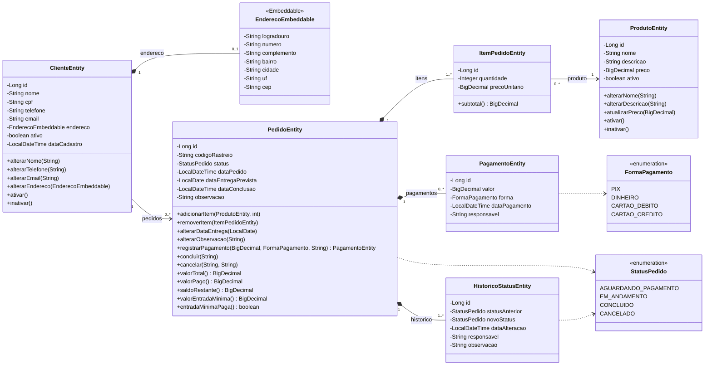

# Diagrama de classes

Entidades do domínio, com atributos, métodos modificadores de estado, relacionamentos e multiplicidades.
O diagrama está em [Mermaid](https://mermaid.js.org/) e é renderizado automaticamente pelo GitHub.
Os getters (gerados com Lombok) foram omitidos para manter o diagrama legível.

## Observações

- **Pedido × Produto (N—N):** resolvido por `ItemPedidoEntity`, que guarda a quantidade e o preço unitário no momento da venda.
- **Pagamento:** um pedido pode ter vários pagamentos (entrada de 50%, quitação na entrega, ou um único pagamento antecipado de 100%). O pedido só passa a `EM_ANDAMENTO` (e recebe o `codigoRastreio`) quando o total pago atinge 50% do valor total, e só pode ser `CONCLUIDO` com o saldo restante igual a zero.
- **Cardinalidade `1..*` em itens:** o pedido só aceita pagamento se tiver ao menos um item. O banco não impõe isso, é regra do método `registrarPagamento`.
- **Responsável:** as ações de pagamento e de mudança de status recebem o nome do funcionário (texto), já que o sistema é de uso interno e não tem cadastro de usuários nesta versão.
